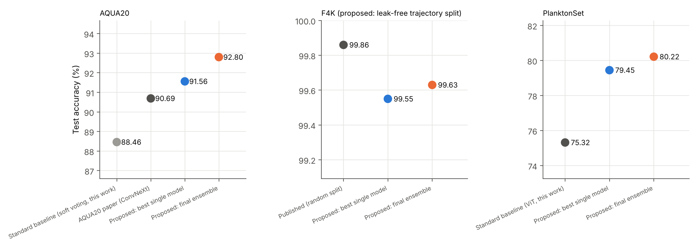
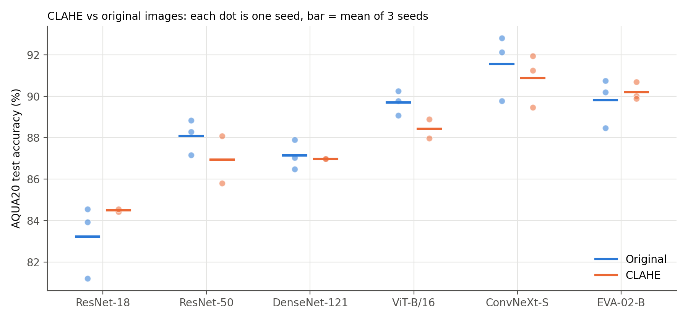
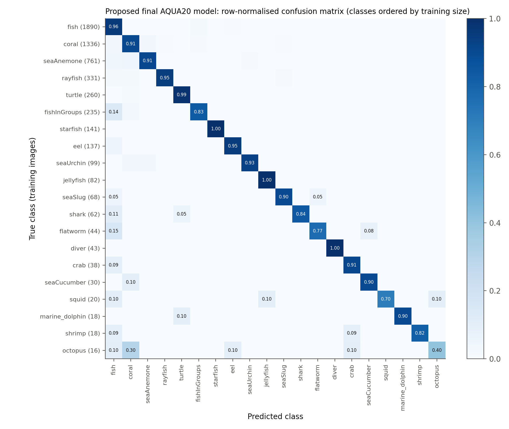
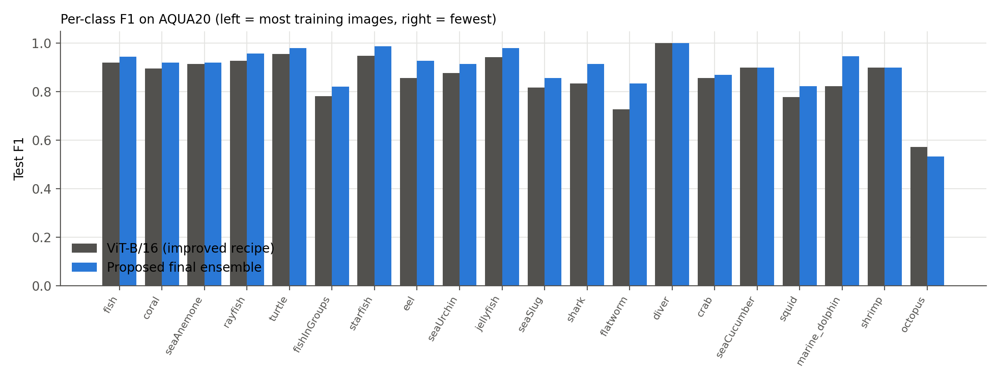
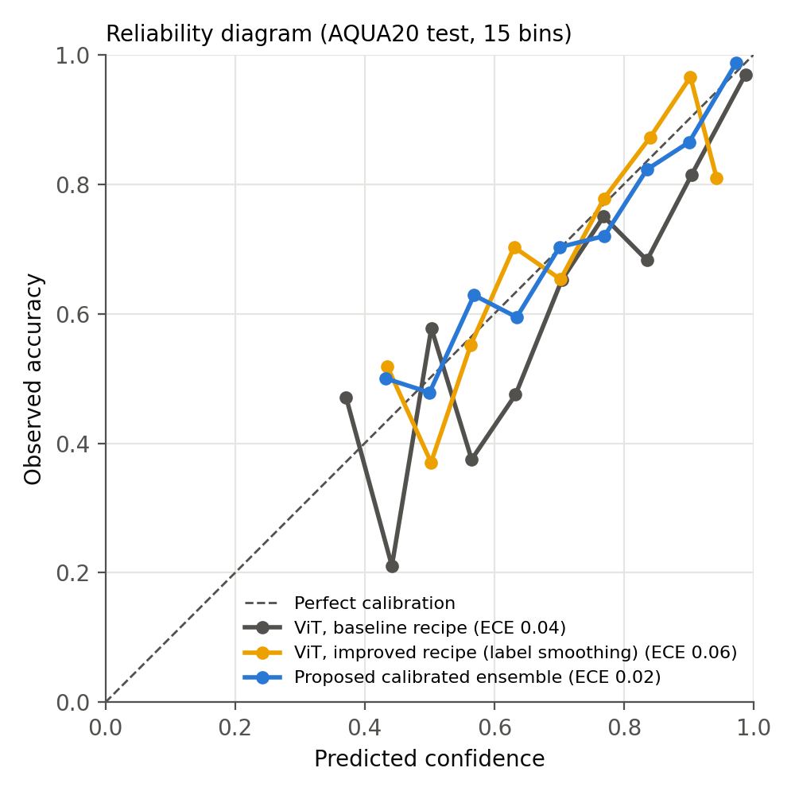
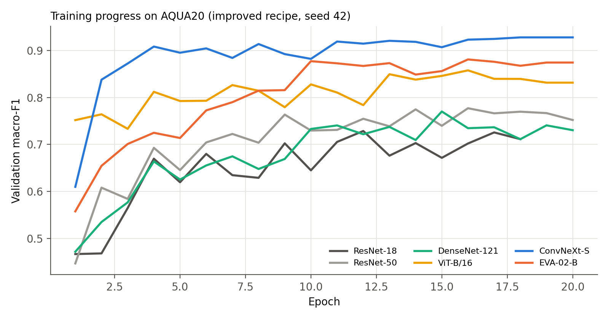

# CLAHE-Enhanced Underwater Image Classification Using Ensemble Deep Learning

M.Tech project (Data Science and Engineering, NIT Agartala).

A leak-free, statistically tested pipeline for underwater image classification on three benchmarks: **AQUA20**, **Fish4Knowledge (F4K)** and **PlanktonSet**. It combines CLAHE preprocessing, an improved transfer-learning recipe, modern backbones and a **calibrated weighted ensemble**, and explains its predictions with Grad-CAM.

## Headline results

| Dataset | Best published | Standard baseline (this work) | **Proposed final model** | Macro-F1 | ECE |
|---|---|---|---|---|---|
| AQUA20 (20 classes) | 90.69% (ConvNeXt, AQUA20 paper) | 88.46% | **92.80%** | 0.897 | 0.021 |
| F4K (23 species, leak-free split) | 99.86% (random image-level split) | – | **99.63%** | 0.947 | 0.004 |
| PlanktonSet (121 classes) | – | 75.32% | **80.22%** | 0.711 | 0.026 |

*Standard baseline* = ResNet-18, ResNet-50, DenseNet-121 and ViT-B/16 fine-tuned with a common recipe (Adam, constant learning rate, plain cross-entropy) and combined by equal soft voting (AQUA20), or ViT-B/16 with the same recipe (PlanktonSet), trained here on the same leak-free splits. The published F4K value was obtained on a random split, which leaks video frames between training and test, so it is not directly comparable.

- **AQUA20:** the final model beats the best published result (90.69%) by 2.1 points. Against ViT-B/16 it is right on 65 images where ViT is wrong, versus 24 the other way (McNemar p < 0.0001). Against the best single model, the macro-F1 gain is significant (+0.019, 95% CI [+0.002, +0.041]).
- **F4K:** 15 errors in 4,022 test images. Against ViT: 20 vs 5 (p = 0.004), macro-F1 95% CI [+0.032, +0.057].
- **PlanktonSet:** against the best single model (ConvNeXt + TTA): 147 vs 114 (p = 0.047), macro-F1 95% CI [+0.005, +0.042].

### Precision and recall (test set)

| Dataset | Model | Macro precision | Macro recall | Macro-F1 | Weighted precision | Weighted recall |
|---|---|---|---|---|---|---|
| AQUA20 | Standard baseline | 0.883 | 0.746 | 0.789 | 0.886 | 0.885 |
| AQUA20 | ViT-B/16 (improved recipe) | 0.912 | 0.833 | 0.862 | 0.904 | 0.903 |
| AQUA20 | **Proposed final model** | **0.927** | **0.878** | **0.897** | **0.929** | **0.928** |
| F4K | ViT-B/16 (improved recipe) | 0.909 | 0.910 | 0.901 | 0.991 | 0.993 |
| F4K | **Proposed final model** | **0.949** | **0.945** | **0.947** | **0.995** | **0.996** |
| PlanktonSet | Standard baseline | 0.673 | 0.619 | 0.629 | 0.756 | 0.753 |
| PlanktonSet | ViT-B/16 (improved recipe) | 0.730 | 0.699 | 0.702 | 0.789 | 0.793 |
| PlanktonSet | **Proposed final model** | **0.744** | **0.703** | **0.711** | **0.796** | **0.802** |

Recall is lower than precision for every model, so the remaining errors are mostly missed images rather than false alarms. The largest gain is in recall: on the five rarest AQUA20 classes the standard baseline reaches precision 0.971 but recall only 0.527, while the final model reaches 0.940 / 0.744. Computed in `figures/make_figures.py` (final-figures notebook).

## Key findings

1. **Data leakage in standard splits.** In AQUA20, 114 of 1,612 test images (7.1%) have a near-duplicate in the training set (perceptual hash distance ≤ 6). In F4K, a random split puts 79.1% of test images in the same video trajectory as training images. All results here use **group-aware, leak-free splits**, and AQUA20 is also reported on a clean test set (92.52%).
2. **CLAHE helps the ensemble more than single models.** On its own, CLAHE (LAB L channel, clip 2.0, 8×8 tiles) helps ResNet-18 and EVA-02 but hurts ViT, ResNet-50 and ConvNeXt (3 seeds each). Inside the ensemble, the CLAHE networks receive about 51% of the learned weight and raise rare-class F1 (bottom-5 F1 0.787 → 0.829).
3. **Calibration matters.** Equal soft voting of label-smoothed models is badly calibrated (ECE ≈ 0.10). Temperature scaling plus validation-learned weights brings it to ECE ≈ 0.02.
4. **Grad-CAM** shows the models attend to the organism. On F4K, only 1.1% of the attention falls on the burned-in timestamp region, so there is no shortcut learning.
5. **Classical baseline (LBP + SVM):** 46.7% on AQUA20, 80.7% on F4K and 47.5% on PlanktonSet, far below deep models.

## Figures

**Proposed model vs published results and the standard baseline**


**CLAHE vs original images, 3 seeds per backbone (AQUA20)**


**Confusion matrix of the final AQUA20 model** (classes ordered by number of training images)


**F1 per class: proposed final ensemble vs ViT-B/16**


**Reliability diagram:** the proposed calibrated ensemble is closest to perfect calibration (15 bins; bins with fewer than 10 images not drawn)


**Validation macro-F1 per epoch (AQUA20, seed 42)**


## Final AQUA20 model

12 networks: **ConvNeXt-Small** (`convnext_small.fb_in22k_ft_in1k`) and **EVA-02-Base** (`eva02_base_patch14_448.mim_in22k_ft_in22k_in1k` at 224 px), each trained on original and on CLAHE images with 3 seeds. Each network is temperature-scaled on validation, and the networks are combined by weighted soft voting with weights learned on validation (log-loss, L-BFGS). Every model and ensemble choice was made on **out-of-fold validation**, and the test set was used once.

## Repository layout

```
prep/        data download, duplicate analysis, leak-free splits, CLAHE (AQUA20, F4K, PlanktonSet)
train/       train.py (all models and recipes), runner.py (2-GPU job runner), experiments/ (exact job lists)
ensemble/    E5–E7 ensembles, final model selection, McNemar and bootstrap significance tests
xai/         Grad-CAM analysis
baselines/   LBP + SVM / Random Forest
figures/     code for the report figures
demo/        Gradio web demo (upload an image → top-5, CLAHE view, Grad-CAM, confidence)
```

Each file is the code of one Kaggle notebook cell, exactly as it was run. A training notebook has three cells: `train/train.py` written to `/kaggle/working/train.py` with `%%writefile`, then `train/runner.py`, then one file from `train/experiments/`. Earlier notebooks ran earlier versions of `train.py`; the version here is the final one and supports every experiment. Some comments and printed labels were reworded after the runs; the code itself is unchanged. The recipe identifier `btech` (as in run names such as `vit_orig_btech_ce_none_s42`) denotes the **baseline recipe** (Adam, constant learning rate, plain cross-entropy) and is kept because the saved Kaggle outputs use these names.

## How to reproduce (Kaggle, 2× T4 GPU)

| Order | Notebook | Code | Inputs |
|---|---|---|---|
| 1 | aqua20-data-prep | `prep/aqua20_01_download_duplicates_splits.py` | Internet ON |
| 2 | aqua20-clahe | `prep/aqua20_02_clahe.py` | 1 |
| 3 | f4k-data-prep | `prep/f4k_data_prep.py` | Internet ON |
| 4 | plankton-data-prep | `prep/plankton_data_prep.py` | Kaggle competition *datasciencebowl* |
| 5 | aqua20-training | `train/` + `experiments/e1_e1b_aqua20.py` | 2 |
| 6 | aqua20-train-e2e3 | `train/` + `experiments/e2_e3_aqua20.py` | 2, 5 |
| 7 | f4k-plankton-train | `train/` + `experiments/f4k_plankton_baselines.py` | 3, 4 |
| 8 | aqua20-seeds | `train/` + `experiments/e9_aqua20_seeds.py` | 2 |
| 9 | aqua20-strong / f4k-strong / plankton-strong | `train/` + `experiments/*_strong_backbones.py` | data + earlier runs |
| 10 | ensembles, final-aqua20, final-f4k-plankton | `ensemble/` | all training runs |
| 11 | gradcam, lbp-baselines, final-figures | `xai/`, `baselines/`, `figures/` | data + runs |
| 12 | aqua20-demo | `demo/` (run interactively, not committed) | 2, aqua20-strong |

Training notebooks are committed with *Save & Run All*. Each run saves `best.pt`, validation and test logits, and `metrics.json`; the ensemble notebooks read only the saved logits.

## Datasets

- **AQUA20:** Hugging Face `taufiktrf/AQUA20` (8,171 images, 20 classes).
- **Fish4Knowledge:** `fishRecognition_GT.tar` from the University of Edinburgh F4K ground-truth page (27,370 images, 23 species).
- **PlanktonSet 1.0:** labelled training set of the Kaggle *National Data Science Bowl* competition (`datasciencebowl`, 30,336 images, 121 classes).

The datasets and trained weights are not included in this repository because of their size and licences.

## Requirements

See `requirements.txt`. Pretrained backbones come from `torchvision` and `timm`.

## References

- Guo et al., *On Calibration of Modern Neural Networks*, ICML 2017 (temperature scaling, ECE).
- Zuiderveld, *Contrast Limited Adaptive Histogram Equalization*, Graphics Gems IV, 1994 (CLAHE).
- Selvaraju et al., *Grad-CAM*, ICCV 2017.
- Liu et al., *A ConvNet for the 2020s*, CVPR 2022 (ConvNeXt).
- Fang et al., *EVA-02: A Visual Representation for Neon Genesis*, 2023.
- Dosovitskiy et al., *An Image is Worth 16x16 Words*, ICLR 2021 (ViT).
- He et al., *Deep Residual Learning*, CVPR 2016; Huang et al., *Densely Connected Convolutional Networks*, CVPR 2017.
